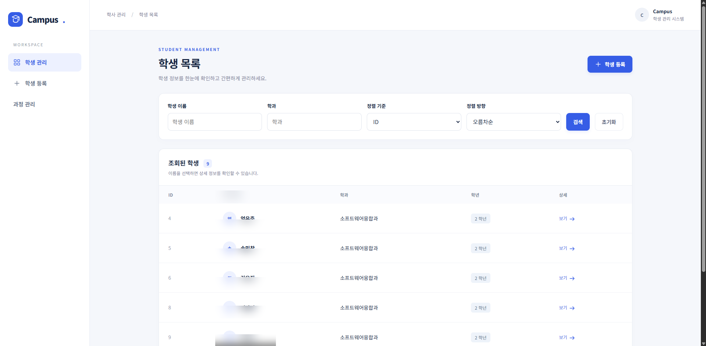
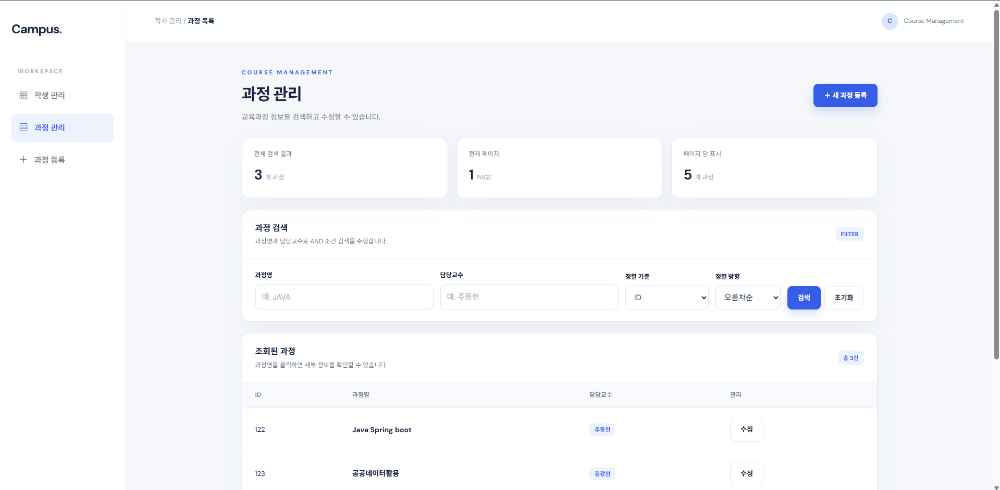
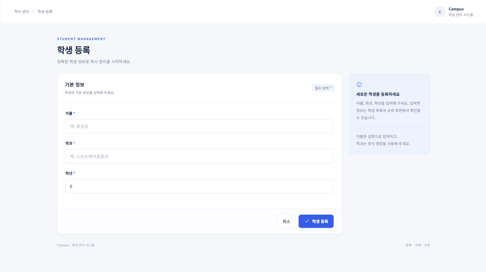
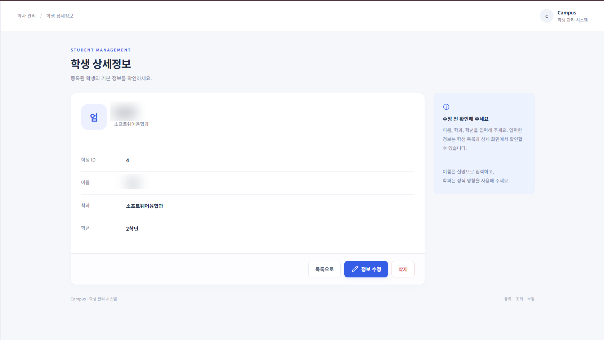
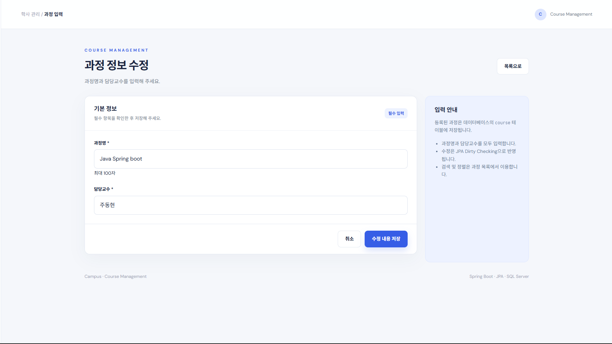
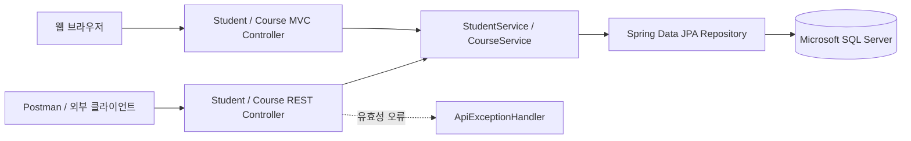

<div align="center">

# Campus — Student & Course Management

**기존 MVC 학생 관리에서 Service 계층 분리와 JSON REST API까지 확장한 학사 관리 실습 프로젝트**

`Java 21` · `Spring Boot 4.1.1` · `Spring Data JPA` · `SQL Server` · `Thymeleaf` · `Postman`

[🖥️ 포트폴리오 웹페이지 (HTML)](docs/index.html) · [📷 실제 화면](#실제-실행-화면) · [🔗 API 명세](#rest-api) · [🧪 검증](#검증-근거) · [🛠️ 시행착오](#개발-과정--시행착오)

</div>

---

## 30초에 보는 프로젝트

> **문제** — 기존 Spring MVC 화면만으로는 앱이나 외부 클라이언트가 학생·과정 데이터를 활용하기 어렵고, Controller에서 DB 작업을 직접 처리하면 기능 확장에 불리합니다.
>
>
> **해결** — `Controller → Service → Repository → JPA`로 역할을 나누고, MVC와 REST Controller가 **같은 Service를 재사용**하도록 구성했습니다. 검색·정렬·페이징과 `@Valid`, 올바른 HTTP 상태코드, JPA Dirty Checking을 함께 적용했습니다.

| 프로젝트 정보 | 내용 |
| --- | --- |
| **형태** | 개인 학습·확장 프로젝트 / 한국폴리텍대학 응용프로그래밍실습 9·10주차 |
| **내가 진행한 일** | 실습 요구사항·구현 범위 정의, AI 도구를 통한 구현 진행, 실제 로컬 SQL Server 연동 및 기능별 검증, 오류 원인 확인, 실행 화면 촬영, 문서 정리 |
| **AI 활용** | 9·10주차 확장 코드 및 문서 초안 생성·수정에 AI 지원 활용. 코드를 모두 수작업으로 직접 작성했다고 주장하지 않음 |
| **강의·기존 소스** | 제공된 `backendintro` ZIP에서 시작. 기존 학생 관련 코드의 최초 작성 기여 범위는 확정하지 않음 |
| **주요 결과** | 학생 / 과정 웹 CRUD, 과정명·담당교수 복합검색, 정렬, 5건 페이징, JSON REST API, 입력 유효성 검사 |
| **검증 근거** | HTTP 인메모리 스모크 **32/32 통과**(도구 실행 기록) + 실제 SQL Server 기능별 동작 **사용자 로컬 검증 완료 보고**(로그·SSMS 증빙은 별도 제출 전) |

## 실제 실행 화면

GitHub에서 이미지를 클릭하면 확대해서 볼 수 있습니다. **아래는 사용자 PC에서 직접 실행해 촬영한 화면**이며, 생성형 이미지나 샘플 렌더링이 아닙니다. 공개용으로 일부 학생 식별 정보만 흐리게 처리했습니다.

<table>
<tr><td width="50%">
<a href="docs/screenshots/student-list.png"></a>
<strong>학생 목록</strong><br/>이름/학과 조건 검색, 정렬, 상세 이동
</td><td width="50%">
<a href="docs/screenshots/course-list.png"></a>
<strong>과정 목록</strong><br/>과정명/담당교수 AND 검색, 정렬, 페이징
</td></tr>
<tr><td>
<a href="docs/screenshots/student-create.png"></a>
<strong>학생 등록</strong><br/>이름·학과·학년 검증
</td><td>
<a href="docs/screenshots/course-create.png"></a>
<strong>과정 등록</strong><br/>과정명·담당교수 필수값 입력
</td></tr>
<tr><td>
<a href="docs/screenshots/student-detail.png"></a>
<strong>학생 상세</strong><br/>DB에서 조회한 상세정보와 수정·삭제 동선
</td><td>
<a href="docs/screenshots/course-edit.png"></a>
<strong>과정 수정</strong><br/>서비스 트랜잭션 안에서 JPA 변경 감지 적용
</td></tr>
</table>

> 이미지에서 UI 구성을 보여주는 것과 API의 HTTP 상태코드를 입증하는 것은 다릅니다. API 검증은 [Postman 컬렉션](postman/Week10-REST-CRUD.postman_collection.json)과 [테스트 기록](docs/week10-http-smoke-results.json)에서 별도로 확인할 수 있습니다.

## 왜 이 구조인가?



- **MVC Controller**: 화면 탐색, 폼 데이터와 Thymeleaf 뷰 반환
- **REST Controller**: JSON 요청·응답, `ResponseEntity` 상태코드, `@Valid` 처리
- **Service**: 트랜잭션 경계, 조건별 검색 분기, 정렬 허용 필드 제한, 수정 객체 변경 감지
- **Repository**: `findBy...Containing`, `...And...Containing`과 `Pageable` 실행

**중복 제거의 기준:** 10주차 Course REST API는 `CourseService`/`CourseRepository`/`Course` Entity를 변경하지 않고 **기존 9주차 Service를 공유**하도록 작성했습니다. 따라서 HTML과 API로 각각 수정해도 동일한 DB 데이터를 다룹니다.

## 구현 기능

| 영역 | 완료된 범위 | 기술적 설명 |
| --- | --- | --- |
| Student MVC | 목록·등록·상세·수정·삭제 | Thymeleaf, `StudentController` |
| Course MVC | 목록·등록·상세·수정·삭제 | `CourseController`, `CourseService` |
| 검색 | 학생 이름/학과, 과정명/담당교수 | 값 유무 4가지 경우 분기 및 AND 복합검색 |
| 정렬 | 오름차순·내림차순 | Student: `id/name/major/grade`; Course: `id/name/teacher` 화이트리스트 |
| 페이징 | 페이지 번호와 검색 조건 유지 | JPA `PageRequest`, Course 5건 단위, 0 기반 페이지 |
| REST CRUD | Student / Course 각각 GET·POST·PUT·DELETE | `200`, `201`, `204`, `400`, `404` 구분 |
| 입력 검증 | POST·PUT 유효성 검사 | `@Valid`, 공통 `@RestControllerAdvice`, 필드별 오류 JSON |
| 수정 | JPA Dirty Checking | `@Transactional` 안에서 영속 Entity 필드 변경, `save()` 재호출 없음 |

## REST API

API의 기준 주소는 `http://localhost:8080`입니다.

| HTTP | Course URI | 의미 / 정상 응답 |
| --- | --- | --- |
| `GET` | `/api/courses` | 조건 검색·정렬·페이징 / `200` + Page JSON |
| `GET` | `/api/courses/{id}` | 상세 조회 / `200`, 없으면 `404` |
| `POST` | `/api/courses` | 과정 등록 / `201` + 생성된 ID |
| `PUT` | `/api/courses/{id}` | 과정 변경 / `200`, 잘못된 값 `400`, 없으면 `404` |
| `DELETE` | `/api/courses/{id}` | 삭제 / `204`(빈 Body), 없으면 `404` |

Student도 같은 패턴으로 `/api/students`를 제공합니다.

**1. 등록 요청** (`Body → raw → JSON`):

```http
POST /api/courses
Content-Type: application/json

{"name":"자바 백엔드 종합실습","teacher":"주동현"}
```

**2. 검색 + 정렬 + 페이징**:

```http
GET /api/courses?nameKeyword=자바&teacherKeyword=주동현&sortField=name&sortDir=desc&page=0
```

- 이름·담당교수 검색어를 둘 다 입력하면 **AND 조건**입니다.
- 허용되지 않은 `sortField`는 `id`로 보정합니다. `page`는 **0부터** 시작합니다.
- 10주차 요구사항에 따라 Course Service의 **5건 고정 페이지** 계약을 유지했습니다.
- 반환값은 배열이 아니라 `content`, `totalElements`, `totalPages`, `number` 등을 포함한 `Page<Course>`의 JSON 표현입니다.

## 개발 과정 & 시행착오

### 01. 기존 코드의 책임을 확인한 뒤 확장

처음에는 학생 CRUD Controller가 DB까지 직접 호출하는 구조였습니다. 강의 지침에 맞춰 Service와 Repository 책임을 분리한 구조를 기반으로 확장했습니다. **9주차 Course 기능은 새로운 Entity·Repository·Service·MVC 흐름이 필요했지만, 10주차 REST는 Service를 다시 만들 필요가 없다는 점**이 중요했습니다. 실제 구현 파일과 기존 파일을 분리해 Git 커밋 이력에 남겼습니다.

### 02. REST에서도 ‘성공’ 응답을 똑같이 내보내면 안 됨

처음 기능 구현만 확인하면 등록·수정·삭제가 모두 성공했다고 판단하기 쉽습니다. 그러나 등록은 `201`, 수정은 `200`, 삭제는 Body 없는 `204`, 없는 자원은 `404`가 명확해야 합니다. `ResponseEntity`로 분기하고, **삭제된 ID를 다시 GET 요청해 404를 확인**하는 테스트 흐름까지 만들어 단순 화면 테스트와 구분했습니다.

### 03. Student PUT 유효성 검사 누락을 발견

원본 Student REST에서는 POST에 `@Valid`가 있었지만 PUT에는 빠져 있었습니다. PDF 실습의 400 오류 요구사항을 대조하는 과정에서 이를 확인했고 PUT에 적용했습니다. Course에서도 POST와 PUT 모두 `@Valid`를 사용해 빈 과정명·담당교수 등 잘못된 요청은 저장되지 않도록 했습니다. **검증이 실패할 때는 공통 예외 처리기가 필드별 오류 JSON**을 반환합니다.

### 04. `save()` 없이 수정되는 과정을 직접 이해

Course 수정 요청은 `CourseApiController → CourseService.update()`로 전달됩니다. Service 트랜잭션 내부에서 영속 객체를 조회한 뒤 이름·담당교수 setter만 호출하고 `save()`는 다시 부르지 않습니다. 트랜잭션 커밋 때 Hibernate가 변경을 감지하여 UPDATE할 수 있다는 점이 핵심입니다. 실제 SQL Server에서의 기능별 검증은 사용자 로컬 환경에서 완료했다고 보고받았으며, **SQL 로그·SSMS 캡처는 이 저장소에 포함되어 있지 않습니다.**

### 05. DB 자격증명 설정에서 서버 기동 실패

SQL Server 연동 중 `사용자 '${DB_USERNAME}'이(가) 로그인하지 못했습니다`라는 오류 로그가 발생했습니다. 이것은 SQL문이나 Course API 문제가 아니라 **IntelliJ 실행 환경변수가 설정되지 않아 로그인 이름이 치환되지 않은 문제**였습니다. 실제 계정은 공개 설정 파일에 저장하지 않고 `DB_USERNAME`·`DB_PASSWORD` 환경변수로 공급하도록 유지했습니다. 사용자는 로컬에서 이 문제를 해결하고 기능별 테스트를 마쳤습니다.

### 06. 테스트를 ‘어디까지 검증했는가’로 구분

별도 Spring Boot/Tomcat 서버에 인메모리 Repository를 연결한 HTTP 검증은 **32/32 통과**했습니다. 이는 URL 매핑, Validation, 상태코드, 검색·페이징의 동작을 입증합니다. SQL Server JPA 트랜잭션까지 검증한 결과라고 혼동해서는 안 됩니다. **사용자 로컬 DB 테스트 완료 보고와 도구 측 HTTP 스모크 결과를 별도로 기록**했습니다.

## 검증 근거

| 검증 항목 | 결과와 근거 |
| --- | --- |
| Java 컴파일 | 기존 구현 결과에서 Java 소스 13개 `javac` 통과 |
| HTTP 스모크 | [32/32 수행 기록](docs/week10-http-smoke-results.json) · 인메모리 Repository 테스트 |
| Postman 시나리오 | [Student/Course 요청 컬렉션](postman/Week10-REST-CRUD.postman_collection.json) · 200/201/204/400/404 검증 조건 구성 |
| SQL Server 및 기능별 동작 | **사용자가 직접 로컬 검증 완료했다고 보고**. 실행 환경의 SQL 로그·SSMS 캡처는 별도 첨부되지 않음 |
| 과제 항목 대응 | [10주차 요구사항 추적표](docs/week10-requirements.md) |

## 로컬 실행

1. Java 21, SQL Server, `BackendIntroDB`를 준비합니다.
2. `DB_USERNAME`/`DB_PASSWORD`를 **IntelliJ Run Configuration → Environment variables**에 설정합니다. `DB_URL`은 기본값이 있으며 다른 DB 주소일 때만 변경합니다.
3. 프로젝트 루트에서 `./mvnw spring-boot:run` (Windows: `.\mvnw.cmd spring-boot:run`)을 실행합니다.
4. 브라우저에서 [`http://localhost:8080/students`](http://localhost:8080/students), [`http://localhost:8080/courses`](http://localhost:8080/courses)를 확인합니다.
5. Postman 컬렉션을 import해 순서대로 실행합니다. 상세 환경변수 예시는 [`.env.example`](.env.example)를 참고합니다.

> 로컬 주소는 본인 PC에서 서버가 실행 중일 때만 열립니다. GitHub README나 정적 소개 페이지 자체가 Spring Boot 서버를 호스팅하지는 않습니다.

## 내가 수행한 범위와 AI 사용 공개

- **실습 자료 / 초기 소스:** 교수 제공 9·10주차 지침, 3일차 Student CRUD ZIP이 출발점입니다. 모든 코드를 개인이 처음부터 작성했다고 표현하지 않습니다.
- **본인 수행:** PDF 요구조건 정리, 완성 기능/예외 케이스 점검, DB 연결 문제 해결, 로컬 SQL Server에서 기능별 검증, 실제 화면 촬영, 포트폴리오에 무엇을 보여줄지 판단했습니다.
- **AI 도구 수행:** 9주차 Course 확장과 10주차 REST 코드 및 자동 검증 보조, README/정적 소개 페이지 초안 작성과 문서 구조화에 활용했습니다.
- **기여도 표기 원칙:** 팀 프로젝트가 아닌 개인 실습 확장입니다. '코드를 모두 직접 작성했다' 대신 **요구사항을 구현 가능한 명세로 만들고 결과를 검증·설명하는 역할**을 정확히 표기합니다.

> **GitHub Pages 공개:** 이 저장소의 `main /docs`를 GitHub Pages에 연결하면 별도 정적 포트폴리오 사이트로 이용할 수 있습니다. 아직 실제 배포 URL은 없습니다. [배포 방법](docs/PUBLISHING.md) 참고.

## 면접에서 설명할 포인트

<details><summary><strong>왜 MVC Controller와 REST Controller를 나눴나요?</strong></summary>HTML을 렌더링하는 클라이언트와 JSON이 필요한 클라이언트의 응답 표현이 다르기 때문입니다. 데이터 작업과 트랜잭션은 같은 Service로 재사용합니다.</details>
<details><summary><strong>Course 수정에서 save()가 없어도 반영되는 이유는?</strong></summary>@Transactional 경계 안에서 조회한 Entity는 영속 상태이고, Hibernate가 필드 변경을 감지하여 커밋/flush 단계에서 UPDATE합니다. 트랜잭션 범위 밖의 detached Entity에는 같은 보장이 없습니다.</details>
<details><summary><strong>검색과 정렬은 무엇이 핵심인가요?</strong></summary>이름/교수 입력 조합을 네 가지로 분리하고, URL에서 받은 정렬 필드는 허용 목록만 사용합니다. Pageable로 DB 차원에서 목록 크기와 정렬을 제한합니다.</details>
<details><summary><strong>어디까지 본인 코드인가요?</strong></summary>기존 강의 실습 ZIP을 기반으로 생성형 AI 지원을 받아 확장했습니다. 요구사항 정의, 검증 시나리오 점검, 로컬 데이터베이스 검증과 화면 캡처 등 실제 수행 범위를 구분해 설명합니다.</details>

---

<sub>강의 자료: 한국폴리텍대학 부산캠퍼스 소프트웨어융합과, 응용프로그래밍실습 9·10주차. 원본 PDF의 무단 재배포 없이 과제에 맞춰 구현한 코드와 문서만 포함합니다.</sub>
